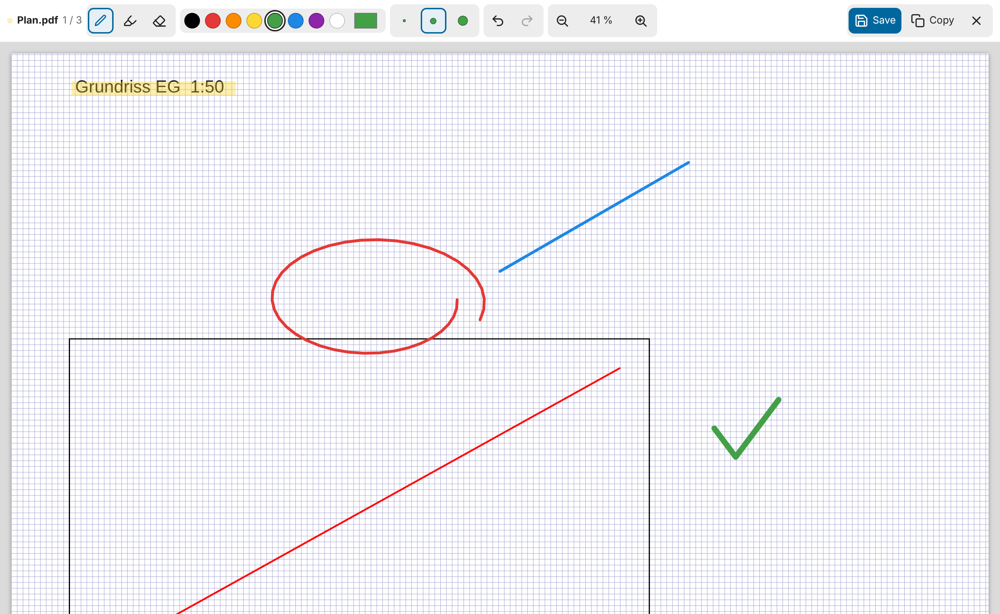

<!--
  - SPDX-FileCopyrightText: 2026 TRGamer-tech
  - SPDX-License-Identifier: AGPL-3.0-or-later
-->
# Zeichenbrett for Nextcloud

**Fast, simple drawing on PDFs and images, right from Nextcloud Files.**



The built-in PDF viewer and image editor turn every stroke into a selectable object with a rectangular hitbox: start a new line inside that box and you drag the old one around instead of drawing. There is no eraser, colors cannot always be changed, and you cannot save a copy after editing.

Zeichenbrett fixes exactly that and stays out of your way:

- **Draw anywhere.** Strokes are never selectable boxes. Where you put the pen down, it draws.
- **Pen, highlighter, eraser.** The eraser removes exactly what it touches, even just part of a line.
- **Colors that work**, three line widths, undo and redo.
- **Save, or save as copy, at any time**, as often as you like, also after you have already saved.
- **Fast.** Opens in a fraction of a second (pdf-lib is only loaded when saving). Pages render on demand and stay sharp at any zoom, even on large CAD plans.
- **Stays editable.** The drawing is stored inside the file, so you can reopen it and keep drawing or erasing without anything being burnt in twice. In PDFs it is also a real PDF layer (Optional Content Group) that other PDF programs can show or hide.
- **Can be the default viewer** for PDF, PNG and JPEG. Admins set the default, every user can override it in their personal settings. This works even with `files_pdfviewer` enabled.
- **Tablet friendly.** Pen or one finger draws, two fingers zoom and pan.
- **Translated** into German (informal and formal), French and Italian.

Supports Nextcloud 31 to 35.

## Usage

- In **Files**, open the **…** menu of a PDF or image and choose **Draw & annotate**, or just click the file if Zeichenbrett is set as default.
- **Default viewer:** *Administration settings → Zeichenbrett* sets the default for everyone. Users can change it under *Personal settings → Zeichenbrett*.

| Key | Action | Key | Action |
|---|---|---|---|
| P / M / E | Pen / highlighter / eraser | Ctrl+Z / Ctrl+Y | Undo / redo |
| 1 / 2 / 3 | Thin / medium / thick | Ctrl+S | Save |
| Shift (hold) | Straight line | Ctrl+Shift+S | Save as copy |
| Space or right mouse (hold) | Pan | Ctrl+wheel, + / - / 0 | Zoom |
| Page Up / Down | Previous / next page | Esc | Close |

## Installation

### From the App Store

Not yet. Until then, install it manually.

### Manually

1. Download `zeichenbrett-<version>.tar.gz` from the [releases](https://github.com/TRGamer-tech/NC-Zeichenbrett/releases).
2. Extract it into the apps folder of your Nextcloud (usually `apps/`, or `custom_apps/` if your `config.php` defines one in `apps_paths`):

   ```bash
   sudo tar -xzf zeichenbrett-*.tar.gz -C /var/www/nextcloud/apps/
   sudo chown -R www-data:www-data /var/www/nextcloud/apps/zeichenbrett
   ```

3. Enable it in **Apps → Disabled apps**, or with `sudo -u www-data php occ app:enable zeichenbrett`.

## Development

```bash
npm install
node build.mjs --watch          # rebuild on change
./deploy-dev.sh /path/to/nextcloud/apps   # copy a build into a local instance
node scripts/l10n.mjs           # check translations, regenerate l10n/
./package.sh                    # build dist/zeichenbrett-<version>.tar.gz
```

### Translations

Source strings are English and live in the code (`t('…')` in JavaScript, `$l->t('…')` in PHP).
Translations are in `l10n/src/<language>.json`. `node scripts/l10n.mjs --list` prints all strings; the same script reports missing translations and generates the files Nextcloud loads.

### How it works

- `lib/`: a little PHP. Loads a ~20 KB bootstrap script into Files, stores the default-viewer settings, allows the pdf.js worker in the CSP.
- `src/main.js`: registers the **…** menu action and a hidden default action. The default action uses a very low `order`, so Files picks it before the Viewer's (and thereby `files_pdfviewer`'s) default action.
- `src/editor/`: the editor, no framework. pdf.js renders, pdf-lib writes (lazy loaded).
  - **PDF:** every annotated page gets one Form XObject with the drawing, bound to an Optional Content Group. A private catalog entry lists every object that was added plus the drawing as JSON. On reopen exactly those objects are removed, so the original stays untouched.
  - **PNG / JPEG:** the drawing and the original image are embedded (PNG chunk `zbRd`, JPEG APP15 segments), so reopening is lossless.
- Files are read and written over WebDAV, `If-Match` prevents overwriting somebody else's changes.

## Known limitations

- Encrypted / password protected PDFs can be viewed but not saved.
- WebP images: the drawing is burnt in (no longer erasable). PNG and JPEG stay editable but grow a bit, because the original is stored with them.
- Public share links are not supported.

## License

[AGPL-3.0-or-later](LICENSE). Bundles [pdf.js](https://github.com/mozilla/pdf.js) (Apache-2.0) and [pdf-lib](https://github.com/Hopding/pdf-lib) (MIT).
